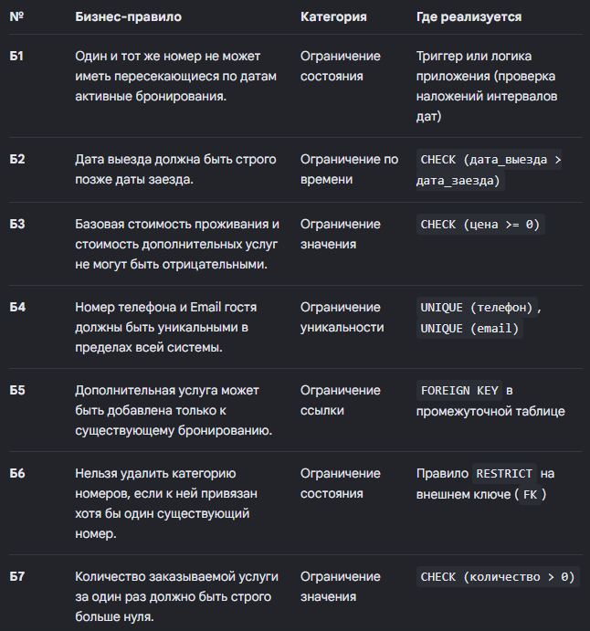
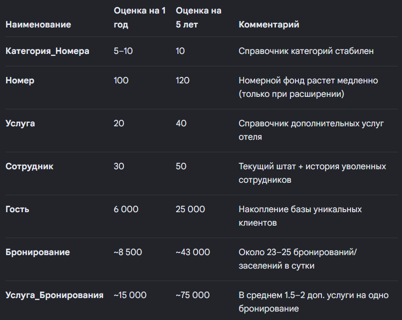
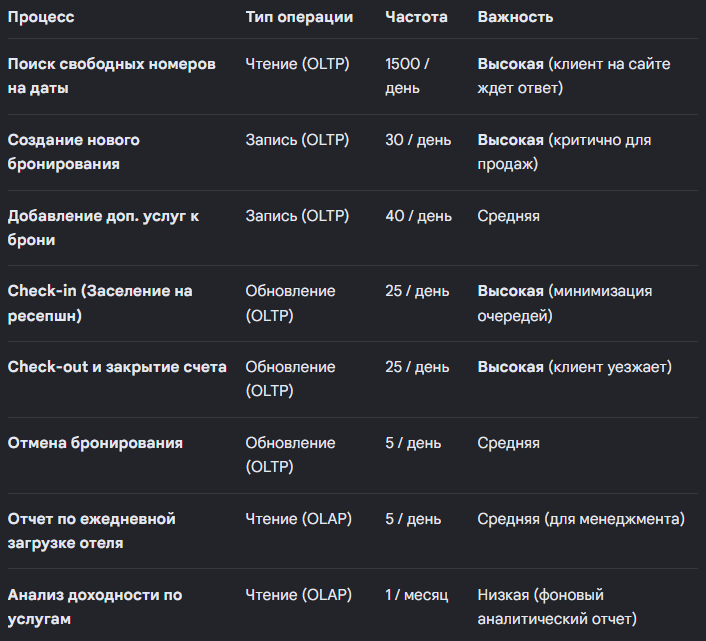
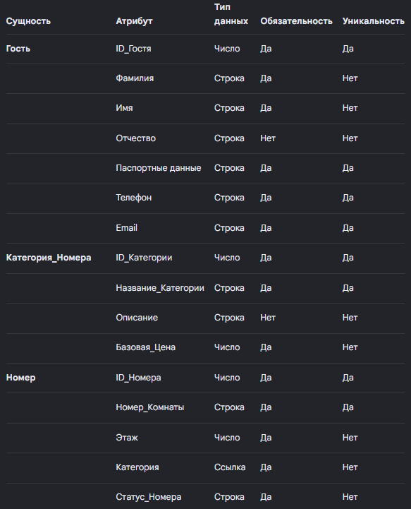
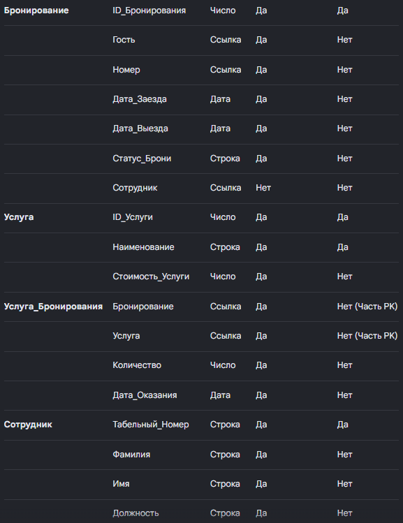

# Этап 1. Сбор и анализ требований — решение кейса «Бронирование номеров в отеле»
## 1. Описание предметной области
Отель предоставляет услуги временного проживания в номерах разного уровня комфорта. Все номера классифицированы по категориям (например: Стандарт, Полулюкс, Люкс, Президентский апартамент), которые определяют базовую стоимость проживания. Номера бронируются гостями на определенные даты. К каждому бронированию гость может заказать дополнительные услуги (например: завтрак, трансфер, спа-процедуры, дополнительное спальное место).
Система должна обеспечивать онлайн-мониторинг свободных номеров, автоматически рассчитывать полную стоимость бронирования (с учетом длительности и набора услуг) и предоставлять менеджменту аналитику по загрузке отеля. Оформлением и заселением занимаются сотрудники (портье/администраторы).
## Ключевые процессы
Каждый процесс представляет собой логическую цепочку действий, изменяющую состояние данных системы.

------------------------------
# 2. Роли пользователей
В системе выделены три основные роли: Гость, Портье (Сотрудник) и Администратор.
## Роль «Гость»
Посетитель сайта/приложения, который регистрируется, ищет варианты, управляет личными заказами и оплачивает их.

## Роль «Портье»
Сотрудник отеля, работающий на стойке регистрации (ресепшн). Оформляет документы, заселяет, выселяет гостей и принимает оплату.

## Роль «Администратор»
Управляющий отеля. Контролирует структуру отеля, тарифную сетку, права сотрудников и формирует аналитическую отчетность.

------------------------------
# 3. Бизнес-правила
Бизнес-правила гарантируют логическую целостность и непротиворечивость данных внутри СУБД.

------------------------------
# 4. Состав данных
Ниже приведена структура абстрактных сущностей (таблиц) и их атрибутов перед переносом в физическую базу данных.
## Таблица «Гость»

## Таблица «Категория_Номера»

## Таблица «Номер»

## Таблица «Бронирование»

## Таблица «Услуга»

## Таблица «Услуга_Бронирования» (промежуточная таблица M:N)

## Таблица «Сотрудник»

------------------------------
# 5. Оценка объёмов данных
Оценка масштабов данных рассчитана для среднестатистического отеля на 100 номеров при средней заполняемости в 70% и среднем сроке проживания 3 дня.

------------------------------
# 6. Частота операций
Определяет транзакционную (OLTP) и аналитическую (OLAP) нагрузку на будущую базу данных.

------------------------------
# 7. Требования к производительности
Критерии скорости отклика СУБД, которые будут закладываться при индексировании на этапе физического проектирования.

------------------------------
# 8. Итоговая сводка сущностей и атрибутов
Сводная таблица, которая выступит прямым техническим заданием для построения концептуальной ER-модели (Этап 2).

